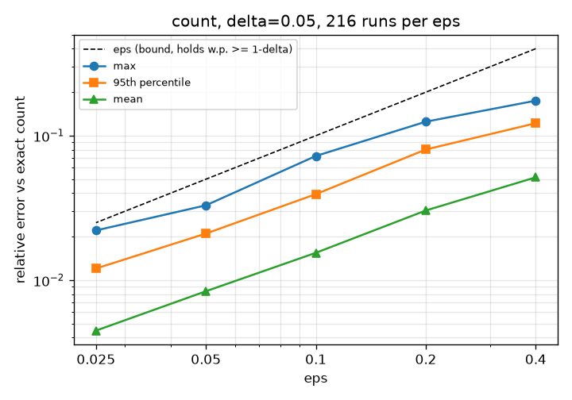

# Benchmark: count vs. exact model counts

This directory checks the (eps, delta) guarantee of `count` empirically and
measures how its run time grows with the number of clauses.

| file | what it does |
|---|---|
| `gen_dnf.py` | random DNF generator: `n` variables, `m` clauses, clause width uniform in `[kmin, kmax]`, distinct variables per clause, random signs, seeded |
| `exact.cpp` | exact counter by enumeration over the variables that occur (at most 30 of them); prints the model count and the satisfying fraction |
| `dmc.py` | subprocess wrapper: `estimate(clauses, n, eps, delta, seed)` and `estimate_file(path, ...)` |
| `run_bench.py` | `accuracy`, `scaling` and `report` (re-summarise `results/accuracy.csv`) |
| `results/` | the CSVs and plot below, as produced on this machine |

On this branch `count` takes optional arguments `count [file.dnf [eps [delta [seed]]]]`
(defaults: `test.dnf`, 0.05, 0.05, nondeterministic seed), so it can be driven
by a script. With a seed the output is reproducible.

```
make bench                       # builds ./count and bench/exact
pip install matplotlib           # only needed for the plot
python3 bench/run_bench.py accuracy --runs 8 --instances 3
python3 bench/run_bench.py scaling --runs 2
```

`count` prints the estimated *fraction* of the 2^n assignments that satisfy
the DNF (the README example prints about 0.5, the exact value being 1/2);
multiply by 2^n for the model count.

## Machine

Intel Core Ultra 7 258V, 6 vCPUs visible to WSL2 (kernel
6.18.33.1-microsoft-standard-WSL2), Ubuntu, g++ 15.2.0, `-O2 -std=c++17`,
GMP 6.3.0. `count` is single-threaded.

The runs below shared the machine with about ten other build/test jobs (load
average 13 to 21 on 6 vCPUs while they ran). Accuracy numbers are unaffected;
times are wall-clock per process, including process start-up and parsing, and
are noisy upper bounds rather than clean timings.

## Accuracy

Instances: n in {10, 16, 20}; (m, width) in {(5, 2..4), (20, 3..6), (80, 5..9)};
3 random instances per configuration (27 instances, exact satisfying fractions
between 0.40 and 0.79); each instance estimated 8 times at each eps with
delta = 0.05 and distinct seeds. Relative error is |estimate - exact| / exact.

| eps | runs | mean rel. err | p95 rel. err | max rel. err | runs with err > eps | median ms/run |
|---:|---:|---:|---:|---:|---:|---:|
| 0.4 | 216 | 0.0515 | 0.1219 | 0.1747 | 0 (0.00%) | 146.9 |
| 0.2 | 216 | 0.0304 | 0.0802 | 0.1250 | 0 (0.00%) | 139.5 |
| 0.1 | 216 | 0.0155 | 0.0394 | 0.0724 | 0 (0.00%) | 147.4 |
| 0.05 | 216 | 0.0084 | 0.0210 | 0.0330 | 0 (0.00%) | 150.8 |
| 0.025 | 216 | 0.0045 | 0.0120 | 0.0221 | 0 (0.00%) | 196.6 |

None of the 1080 runs exceeded eps; delta = 0.05 would have allowed about 5%
of them to. The mean error is roughly eps/8 and scales linearly with eps. At
these sizes the per-run time is almost entirely process start-up.



Raw data: `results/accuracy.csv` (one row per run, with seed).

## Scaling

n = 10000 variables, clause width 15..25, m from 10^3 to 10^5 (input file of
about 11 MB at m = 10^5), 2 runs per point, delta = 0.05. No exact reference at
this size; the stdev column is across the 2 runs.

| n | m | eps | median wall s (incl. parsing) | mean estimate | stdev |
|---:|---:|---:|---:|---:|---:|
| 10000 | 1000 | 0.1 | 0.600 | 0.005641 | 0 |
| 10000 | 1000 | 0.05 | 1.801 | 0.005631 | 4e-06 |
| 10000 | 10000 | 0.1 | 4.006 | 0.05456 | 0.0001 |
| 10000 | 10000 | 0.05 | 13.707 | 0.05423 | 0.00024 |
| 10000 | 100000 | 0.1 | 31.429 | 0.4314 | 0.0044 |
| 10000 | 100000 | 0.05 | 11.966 | 0.4269 | 0.00039 |

The m = 10^5 times are dominated by load from other jobs: the eps = 0.1 point
took 31 s here but 6.3 s in an earlier single run of the same configuration
(`./count big.dnf 0.1 0.05 1`, 6.32 s, 32 MB max RSS), and it is slower than
the eps = 0.05 point, which cannot hold on an idle machine since a smaller eps
only raises the trial threshold. Re-run on an idle machine for timings worth
quoting. Peak memory of the whole scaling run, including Python, was 100 MB.

## Limits noticed while doing this

- `readDNF` copies each clause through a fixed 200-int buffer, so a clause
  with more than 200 literals overflows it. `gen_dnf.py` and `dmc.py` refuse
  such clauses.
- If the input file cannot be opened, upstream `count` reads an uninitialised
  header; this branch checks the file first and exits with status 2.
